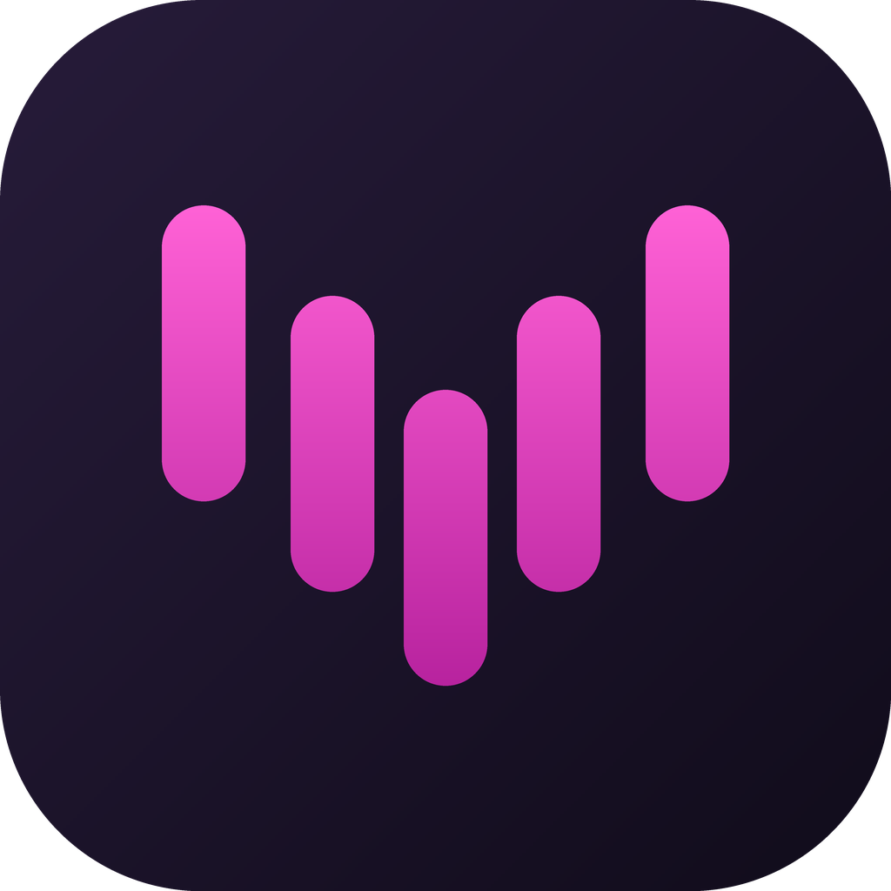
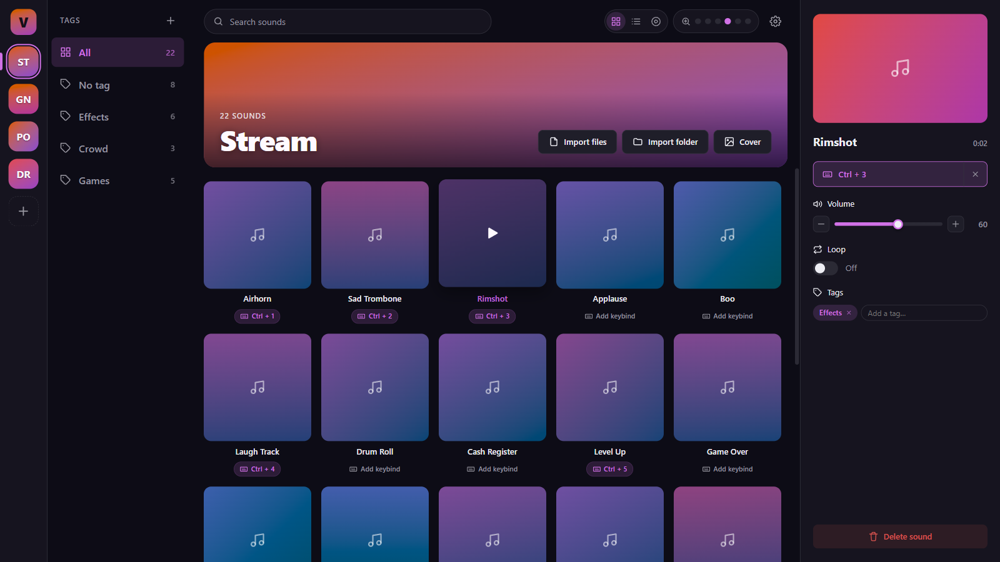
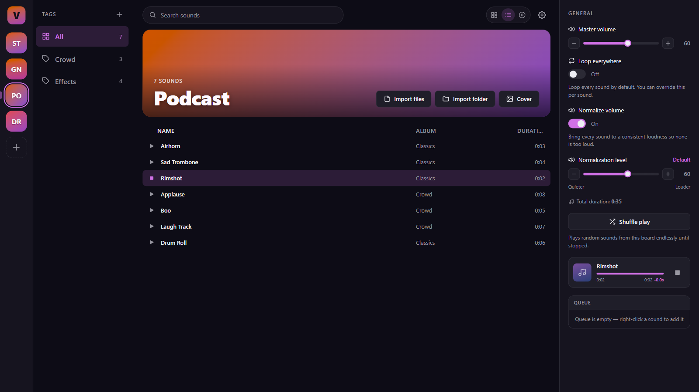
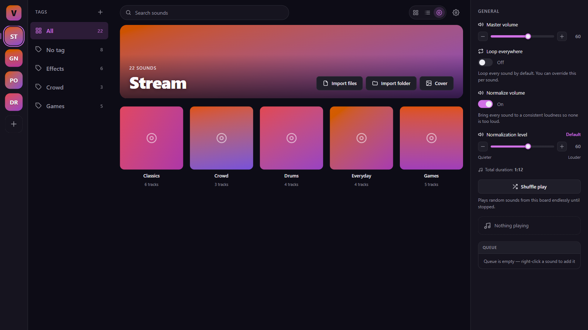

<p align="center">
  
</p>

<h1 align="center">Voxpad</h1>

<p align="center">
  A fast, local soundboard for voice chat.<br>
  Organize clips into boards, fire them with a click or a global hotkey, and let your friends hear them.
</p>

<p align="center">
  <a href="https://github.com/L-at-nnes/Voxpad/releases/latest"></a>
  <a href="https://github.com/L-at-nnes/Voxpad/actions/workflows/ci.yml"></a>
  <a href="LICENSE"></a>
</p>

<p align="center">
  
</p>

## Why Voxpad

Most soundboards are either a bloated voice-changer suite or a barebones file list. Voxpad sits in between: a dark, dense interface built for long sessions in the tray, and nothing that gets between a keypress and the sound.

- **Instant.** Playback runs on a native Rust audio engine.
- **Global hotkeys.** Bind a sound to a key combination; it fires while you are in-game and Voxpad is minimized.
- **Heard by others.** Route sounds to a virtual microphone (VB-Cable) so they come through in Discord, games or any voice app, while you keep monitoring on your own speakers.
- **Portable.** One folder, no installer. Copy it to a USB stick and carry on.
- **Local only.** No account, no cloud, no telemetry.

## Screenshots

<p align="center">
  
  
</p>

## Download

Grab the latest `VoxPad-vX.Y.Z-windows-x64-portable.zip` from the [Releases](https://github.com/L-at-nnes/Voxpad/releases/latest) page, extract it anywhere, and run `voxpad.exe`.

Requires Windows 10 or 11 (x64) and the WebView2 runtime (already present on Windows 11). To be heard by other people you also need [VB-Cable](https://vb-audio.com/Cable/); Voxpad can install it for you from **Settings → VB-Cable**.

New here? Read the [getting started guide](docs/getting-started.md).

## Features

| | |
|---|---|
| **Soundboards** | Any number of boards, each with a cover image or a gradient generated from its name. |
| **Import** | Add a folder or individual `.mp3`, `.wav` and `.flac` files. Imports are deduplicated by content; a refresh button re-scans known folders for new files only. |
| **Playback** | One sound at a time per board, optional loop, queue, history with previous/next, seek, infinite shuffle with a short crossfade. |
| **Views** | Cards, List or Album per board (albums come from the files' tags), six zoom levels. |
| **Tags** | Tag sounds and filter any board by tag, including a live *No tag* filter. |
| **Hotkeys** | Per-sound global keybinds that work while minimized to the tray. |
| **Audio routing** | Pick one or several output devices (monitoring and virtual mic), loudness normalization with an adjustable strength. |

The full tour is in the [usage guide](docs/usage.md).

## Building from source

You need [Rust](https://rustup.rs/) (stable), Node.js 18+, and on Windows the MSVC build tools.

```powershell
git clone https://github.com/L-at-nnes/Voxpad.git
cd Voxpad
.\build.ps1
```

The script builds the frontend and the backend, then assembles a self-contained `VoxPad-Portable/` folder next to the script (executable plus the VB-Cable installer). More detail, including the dev loop, in [docs/building.md](docs/building.md).

Linux (X11) can be built from source with the [Tauri prerequisites](https://tauri.app/start/prerequisites/), but it is not packaged and is less tested than Windows.

## Contributing

Bug reports, ideas and pull requests are welcome. Start with [CONTRIBUTING.md](CONTRIBUTING.md) and the [architecture overview](docs/architecture.md) to find your way around the code.

## Credits and license

Voxpad started as a rework of [Soundux](https://github.com/Soundux/Soundux) and has since been rewritten around a Rust + [Tauri](https://tauri.app/) backend. It is not affiliated with Soundux. VB-Cable is a product of [VB-Audio](https://vb-audio.com/); Voxpad does not modify it.

Released under the [GPL-3.0](LICENSE).
