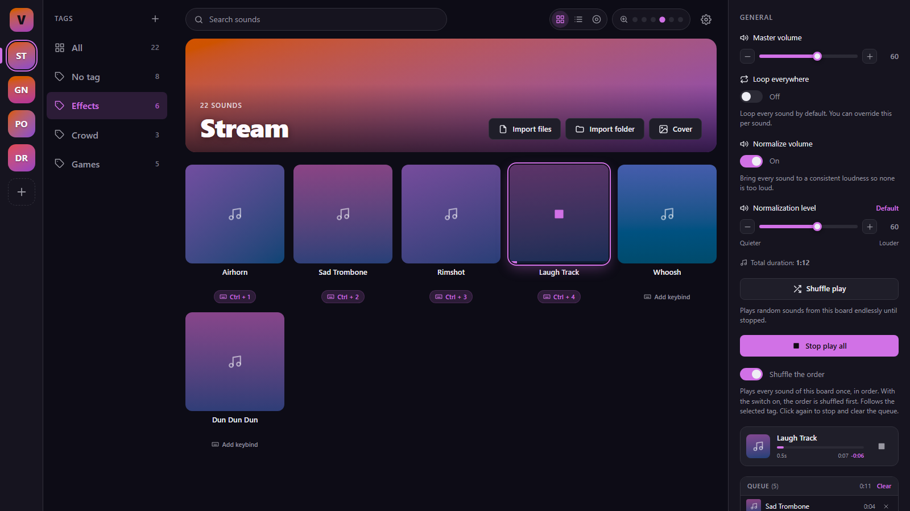

# Usage

## Soundboards

The left rail lists your soundboards. `+` creates one. Drag a board up or down to put it where you want; the order is saved. A board has a name and an optional cover; without a cover, a gradient is generated from its name so every board stays recognizable.

Right-click a board to delete it, or to **merge it into another soundboard**: pick the destination and a tag name (the board's name by default). Every sound moves there under that tag and the board is removed.

Each board remembers its own view mode and zoom level.

### Covers

Pick any `.png`, `.jpg`, `.gif`, `.webp` or `.bmp` image. Voxpad stores a resized copy under `data/covers/`: a small square thumbnail for the rail, and a banner version that is shown whole at the top of the board over a blurred copy of itself. The original file is never touched, and the cover keeps working if you move or delete it. An animated GIF uses its first frame.

## Importing sounds

- **Import files** picks individual `.mp3`, `.wav` or `.flac` files.
- **Import folder** imports every supported file in a folder.
- Imports are deduplicated by file content: importing the same folder twice never creates duplicates.
- Once a board has imported folders, a **refresh** button appears next to *Import folder*. It re-scans those folders and adds only the new files.

Artist, album, year, track and disc tags are read from the files at import time.

## Playing

| Action | Result |
|---|---|
| Click a tile | Plays the sound. Clicking it again stops it. |
| Play another sound in the same board | Cuts the current one. Other boards are independent. |
| Right-click a tile | *Add to queue* or *Manage tags*. |
| Queue | Queued sounds play one after the other as each finishes. |
| Playback bar | Elapsed and remaining time, seek, previous/next through the board's history. |
| **Shuffle play** | Endless random playback for the current board, with a ~200 ms crossfade on skip and seek. Sounds are drawn at random each time, so repeats happen before everything has played. |
| **Play all** | Plays every sound of the current board once, then stops, so each one comes out exactly once. Turn on **Shuffle the order** (off by default, remembered) to shuffle the list first. The button shows how many sounds it will play. |

### Play all

*Play all* sits under *Shuffle play* in the inspector. It follows the tag rail: with a tag selected it plays only that tag's sounds, with *No tag* only the untagged ones. The first sound starts immediately and the rest are loaded into the board's queue, so *previous/next* and the playback bar work as usual. Starting it replaces the board's queue and stops endless shuffle if it was running.

  

## Views

The toolbar switches the current board between three views:

- **Cards**: a grid of tiles with six zoom levels, a global default and a per-board override. Long names wrap on two lines so they stay readable at small sizes.
- **List**: one row per sound with name, album and duration.
- **Album**: sounds grouped by their album tag. Open an album for its tracklist, then play it in order or shuffled.

## Tags

Add tags to a sound from its inspector or the right-click menu. The tag rail filters the board: *All*, *No tag* (sounds without any tag, updated live), then your tags. Shuffle and Play all stay within the active filter. Drag a tag up or down to reorder the rail.

Right-click a tag for two actions that work across soundboards:

- **Turn into a soundboard** asks for a name and moves the tag's sounds to a new board (same zoom, view and sort as the original). The tag is removed from the original board, and is not repeated on the moved sounds since the board now plays that role.
- **Move to…** lists the other boards. Pick one to move the tag and all its sounds there. Dropping a tag from the rail onto a board in the left rail does the same.

Moving a tag moves the audio files too, so deleting a sound later still only touches Voxpad's own copy. If a file can't be moved, that sound stays where it was. A tag that already exists on the destination (whatever its case) is merged with it.

## Inspector

The right panel has two faces.

- **No sound selected**: master volume, loop everywhere, loudness normalization and its strength, default zoom, shuffle, play all, now playing and queue.
- **A sound selected**: its keybind, its own volume, loop and tags.

## Hotkeys

Keybinds are global and keep working while Voxpad is minimized to the tray. Click **Add keybind** in a sound's inspector, press the keys, done; the cross removes it.

## Settings

| Setting | Effect |
|---|---|
| Output device | Where sounds are sent. Select several to monitor and feed the virtual mic at once. |
| VB-Cable | Detects the driver and installs it from the bundled installer. |
| Minimize to tray on close | Closing the window hides Voxpad instead of quitting. |
| Launch on Windows startup | Starts Voxpad minimized to the tray. The registry entry is rewritten to the current folder on each launch, so moving the folder is safe. |
| Default grid zoom | Tile size for boards without a custom zoom. |

## Data and backups

Everything lives in `data/` next to the executable: `config.json` (boards and settings), `sounds/` (imported copies), `covers/` (cover thumbnails and banners), `trash/` (deleted sounds, when *delete to trash* is on) and `voxpad.log`. If `config.json` cannot be read, it is renamed `config_old_<timestamp>.json` instead of being overwritten.
